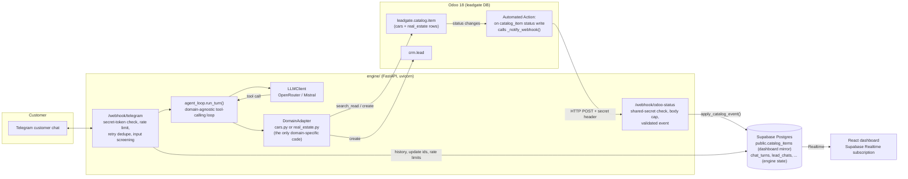
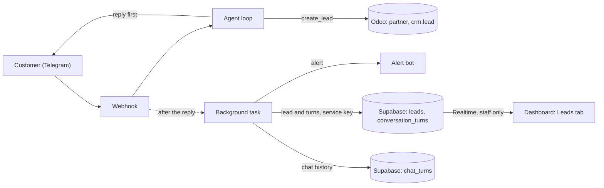
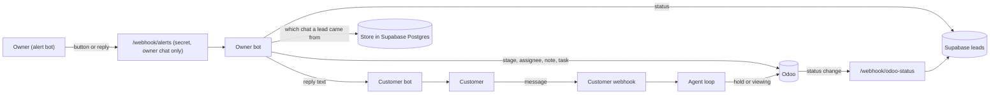

# Architecture

## Data flow

## The lead path

A lead goes through five steps. Only the Odoo step and the reply are on the request path;
everything after the reply is best-effort, so a fault there cannot lose the lead or delay
the customer.

1. **Odoo.** The lead tool finds or creates the partner from the email or phone the customer
   typed, tags the lead, and returns the same lead if this customer asked for the same item
   a few minutes ago.
2. **The reply.** The customer's answer goes out before anything else.
3. **The background task.** After the reply, a background task alerts the owner, mirrors the
   lead and the conversation turn to Supabase, and keeps the turn in the store. It runs
   off the request path, so a slow Telegram or Supabase cannot hold up the next customer.
4. **If the turn fails halfway.** Tool calls are reported as they finish. If the model fails
   after a lead was created, the owner is still alerted, the customer is told to resend, and
   the resend returns the same lead.
5. **The dashboard.** The Leads tab reads the two Supabase tables. Row level security lets
   only staff accounts read them, and new rows arrive over Realtime.

## After the lead

Once a lead exists the owner can act on it from Telegram, and the assistant can do two more
things for a customer.

1. **Follow-up.** When a lead is created it is assigned to a salesperson and gets a call task.
2. **Holds.** The assistant asks Odoo to hold an item. Odoo takes a lock, checks that the item
   is available, that the customer has no other hold and that the overall limit is not
   reached, and records the hold, all in one transaction. It reads the current state through a
   separate database connection opened after the lock is granted, because a transaction only sees
   the database as it was when it started, and a hold committed a moment earlier would otherwise
   be invisible. `scripts/verify_holds.py` proves it by firing six holds at once against a cap
   of one. The status change then travels to the
   dashboard the way any change does. A scheduled job in Odoo releases holds that have lapsed.
3. **Viewings.** A viewing is a lead with a meeting on the requested day. It does not change
   the item.
4. **The owner's buttons and replies.** They arrive at a webhook of their own and are handled
   by `engine/owner_bot.py`, which is given its dependencies (Odoo, the store, both bots) so it
   can be tested without any of them.
5. **Replying to a customer.** Replying to an alert relays the text to the customer and logs it
   on the lead. The store keeps which chat each lead came from, since the dashboard only has a
   one-way hash of it. The assistant is not muted: the customer's next message is answered as
   usual.

## What each piece does

**Telegram to engine.** Telegram delivers updates to `POST /webhook/telegram`. The
handler checks `X-Telegram-Bot-Api-Secret-Token` with a constant-time comparison before
touching the request body, applies a per-`chat_id` rate limit (10 requests / 60s),
ignores an `update_id` it has already processed (Telegram redelivers unacknowledged
updates), strips control characters and chat-template tokens from the text, caps its
length (2000 characters), and turns away messages that match known injection phrasings
before any LLM call is made. Everything else goes to the agent loop.

**Agent loop, adapter, Odoo.** `engine/core/agent_loop.py` is the entire decision
engine, and it has never seen the word "car" or "bedroom." It injects a domain-agnostic
system prompt, sends the conversation plus whatever tool schemas the active adapter
declares to the LLM, executes any tool call the model makes by calling
`adapter.execute_tool(...)`, and, if the model called a tool, makes a second LLM call to
turn the raw tool result into a grounded natural-language reply. If a call was rejected
only for bad arguments and nothing was written yet, the model first gets one more round
with tools to correct it, within the same three-call cap. `CarsAdapter` and
`RealEstateAdapter` are the only two files that know their domain's vocabulary; each
translates a tool call into an Odoo `search_read` domain filter or a `crm.lead` create.
An adapter sets its `domain_type` and the `crm_tag` its leads get (a class without them is
refused when it is defined), defines its search
tool's argument model, and reuses `shared_tools(noun)` for the lead, hold and viewing
tools; `engine/tests/test_third_adapter.py` adds a third catalog that way without
touching `engine/core`. Both read and write through `leadgate.catalog.item`, a single
domain-agnostic model (`odoo/addons/leadgate_domain/models/catalog_item.py`) with a
`domain_type` selection field distinguishing `cars` from `real_estate` rows.

**Guardrails.** `engine/core/guardrails.py` sits around the agent loop and, like the loop,
knows nothing about cars or property. Each tool's arguments are a Pydantic model
(`engine/core/tools.py`) that both generates the schema the LLM is shown and checks what
the model sends back before an adapter sees it: unknown keys dropped, numbers coerced and
range-checked (a fraction for a whole-number field is an error, not rounded), strings
trimmed to one line and length-capped, enums enforced. A turn executes at most three tool calls, state-changing tools (lead, hold, viewing) are
limited to three per chat per hour, and a lead's price is only recorded when a catalog item really has it. The
final reply has links removed and is replaced outright if it repeats a chunk of the system
prompt. The system prompt itself tells the model to treat customer text and tool results
as data. `eval/run_redteam.py` attacks all of this with 38 adversarial messages and checks
the outcome deterministically.

**Conversation memory.** The last 20 turns of each chat live in an in-memory cache limited
to 1000 chats (least recently used out). The durable copy is the store's `chat_turns` table
in Supabase Postgres: when a chat is not in the cache, for example after a restart, its recent
turns are read back before the reply is generated. Turns that the injection screen blocked
are kept for the record but never replayed.

**The store.** `engine/store.py` is one small interface (`Store`) with two implementations: `SupabaseStore`,
which talks to Supabase's REST interface with the service key, and `InMemoryStore`, which tests use and
which an engine started without `SUPABASE_URL` falls back to (it says so in the log and forgets
everything on restart). Plain `httpx`, already a dependency, is enough; no database driver is added to the
engine. What it holds: each chat's turns, which chat each lead came from, which alert message belongs to
which lead, the update ids already handled, the rate-limit counters, and per-lead flags. Anything that must
happen once is one statement that decides atomically: handling an update inserts its id with `ON CONFLICT DO
NOTHING` and the caller that inserted the row wins, and a rate-limit hit is a database function that
increments and returns the new count. Nothing reads first and writes after. The tables are created by
`migrations/0003_engine_state.sql` with Row Level Security on and no policy, so only the service key can
touch them. If Supabase cannot be reached, a turn does not fail: history starts empty, an in-memory check
still drops a repeated update id, the rate limit is counted in memory, and `GET /ready` reports the store
down. After a failed call the store is not tried again for ten seconds, so an outage costs a customer one
timeout, not one per call.

**Odoo to the engine.** A `base.automation` rule watches `leadgate.catalog.item`'s `status` field for writes
and calls `_notify_webhook()`, which POSTs `{id, domain_type, status, name, price, write_date}` as JSON to the
URL in the `leadgate.status_webhook_url` system parameter (the engine's name on the Compose network, since
the POST originates inside the Odoo container), with the shared secret from `leadgate.status_webhook_secret`
in the `X-Odoo-Webhook-Secret` header. If either parameter is unset the call is a silent no-op, and a
delivery failure never blocks the record write that triggered it.

**The status webhook.** `POST /webhook/odoo-status` (`engine/odoo_status.py`) answers 503 until
`ODOO_WEBHOOK_SECRET` is set to at least 16 characters, checks the header in constant time before reading the
body, caps the body at 8 KiB and validates every field. It answers `202` and applies the event after the
response, because Odoo makes the call inside its own write with a 5 second timeout. The upsert is one
database function, `apply_catalog_event`: it inserts the row or updates it only when the event's write time is
not older than the row's `updated_at`, so a replay changes nothing, a late event is ignored, and two
simultaneous deliveries make one row. Transient Supabase errors (network, 429, 5xx) are retried with a
growing pause, four attempts in all; an event that still fails is logged by item id and dropped (Odoo has no
retry queue; `scripts/backfill_supabase.py` resyncs everything).

**Supabase to dashboard.** The React dashboard (`dashboard/`) does an initial fetch of
`catalog_items` and then subscribes to Postgres changes over Supabase Realtime, so the
key board, tallies and sign-out sheet update within a second or two of a
change in Odoo, with no polling.

## Observability

Each customer turn leaves a trace (`engine/tracing.py`): the model that answered every call
(`FailoverLLM` records each model it tried, so a failover is visible), token counts and cost, the
duration of the turn and of the model calls, how each tool call ended, whether the retry round or a
failover was used, and the outcome. `run_turn` fills it and the webhook completes it with the update id,
a keyed `chat_ref` and the outcome, then writes one JSON line to the `leadgate.trace` logger and to
`TRACE_FILE`. `engine/logging_setup.py` formats all logs as JSON, stamps every line of a request with
its update id and `chat_ref` through `contextvars` (which reach the worker threads), and masks tokens
and keys. `GET /ready` reports whether Odoo, the store and the model configuration are usable, while
`GET /health` only says the process is alive. `eval/trace_summary.py` turns a trace file into latency,
token, cost and cost-per-lead figures.

## Why one database

An earlier version kept a second, document database for an append-only event log and the chat history, and
ran a workflow tool to fan each status change out to both databases. Both are gone. Postgres already holds everything
the dashboard reads, and a chat's history, the lead-to-chat map and the dedupe and rate-limit counters are
small, relational and want atomic single-statement updates, which a Postgres function or an
`ON CONFLICT` insert gives directly. One service means one set of credentials, one place for Row Level
Security, and migrations that are plain SQL files in the repository. The cost: the old raw event log
(`catalog_events`, every webhook payload as received) no longer exists. The dashboard never read it and the
current row is what matters; if a history of status changes is wanted, it would be a new table and a few
lines in `apply_catalog_event`.
