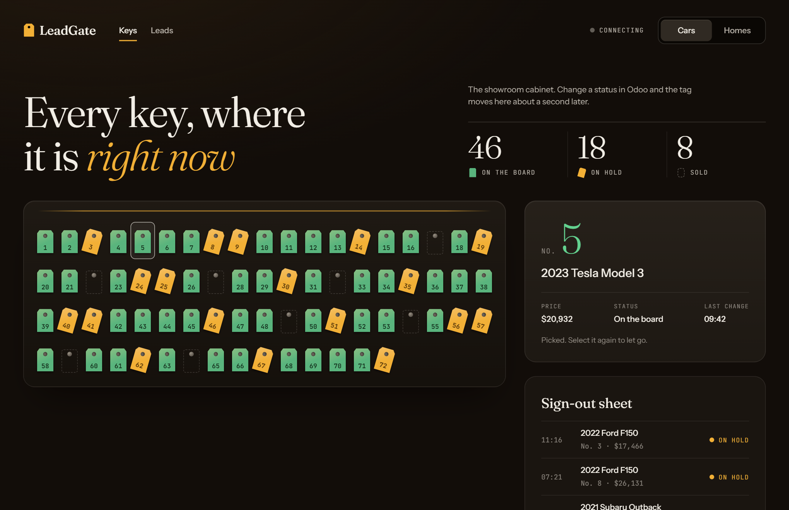
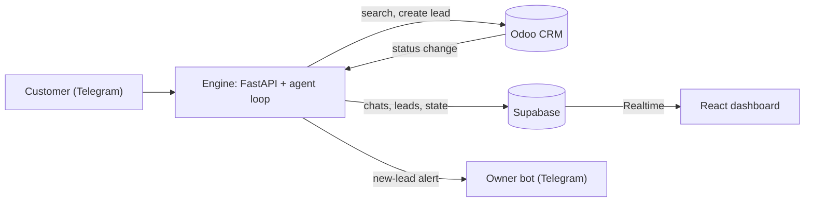

# LeadGate

A Telegram assistant that answers customers from a catalog and hands serious buyers to a person as a lead in Odoo. It runs on two very different datasets, used cars and real estate, to show the same system can work on any catalog.




## Why

Small sellers get the same questions all day and lose buyers who wait for a reply. LeadGate answers at once from the catalog and passes the buyer to a human with the chat attached. It is a personal project, not a production service.

## Demo


About 110 seconds on live services. The customer side of Telegram is simulated. [Full-quality video](docs/demo/leadgate-demo.mp4).

## How it works



1. A customer writes to the bot.
2. The agent searches the catalog or creates a lead, using tools that talk to Odoo.
3. It is instructed to answer only from what the tool returned.
4. The owner gets an alert with buttons. Status changes in Odoo show on the dashboard within about a second.

More detail: [ARCHITECTURE.md](ARCHITECTURE.md).

## What it does

- **Search** by make, model, price, year, mileage and place for cars, and by price, city or state for homes.
- **Leads** go to Odoo with a contact, the chat source and the catalog item.
- **Holds and viewings** are requests. The owner confirms them in Telegram.
- **Owner alerts** with buttons to take, win, lose or reply to a lead, or to block a customer.
- **Buttons for the customer too.** A list of results comes with one button per item. Tapping an item shows it and offers Hold it, Book a viewing and Have someone call me. A viewing asks for the day and the part of the day with buttons, also when the customer types the request without a day. A long list has a Next 5 button. A tap that asks for something never acts alone: it becomes the sentence the customer would have typed, so the name and contact are still asked for and every guard still runs.
- **"The third one" means the third one.** The position is worked out in code from what the customer was shown, not left to the model.
- **Held and sold items are never offered.** If a customer asks about one by car name or place, the assistant can say it is on hold or sold. When a customer asks in English whether an item is still available, the engine prompts the model to search again instead of relying on the earlier list.
- **Live dashboard** with a key for every item, a staff-only Leads tab and the chat behind each lead.
- **Works on different data.** Cars and real estate are two unrelated datasets with their own fields and filters. The agent code in `engine/core/` has no car or home words, so a new catalog needs only a small adapter, not a rewrite.

## Quick start

You need Docker, Python 3.11+, Node.js, and free accounts for Telegram, Supabase, Kaggle and one model provider (NVIDIA, OpenRouter or Mistral).

```bash
cp .env.example .env            # fill it in
docker compose up -d            # Postgres and Odoo
pip install -r requirements.txt -r requirements-tools.txt   # the tools file is for the setup scripts
python scripts/apply_migrations.py
uvicorn engine.main:app         # the engine
cd dashboard && npm install && npm run dev
```

Creating the Odoo database, loading the data and registering the Telegram webhook take a few more steps. [docs/SETUP.md](docs/SETUP.md) has all of them in order.

## Example

> **Customer:** I'll take the 2020 Toyota Camry at $21,834. I'm Sarah Connor, sarah.connor@example.com, please call me this week.
>
> **Assistant:** Got it, Sarah. I've submitted your request for the 2020 Toyota Camry at $21,834. A human sales specialist has your contact info and will reach out this week.

The agent called `create_lead(...)`. The lead shows in Odoo and on the dashboard's Leads tab. [docs/WALKTHROUGH.md](docs/WALKTHROUGH.md) follows one customer from first message to the owner's buttons.

## Safety

Anyone can message a public bot, so the limits are in code and do not rely on the model behaving. They include input screening, checked tool arguments, a lead price checked against the item the lead names, per-chat limits, one active hold per Telegram account, a block list for the owner, no links in replies, and an owner channel that only accepts the owner. The engine logs into Odoo with a limited account, chat text is deleted after 90 days, and the engine's own tables can be encrypted.

Prompt injection cannot be fully solved. At worst, a hijacked assistant places a few leads or holds on real items at their catalog price, and a person confirms each one. It cannot edit a lead, reach the owner's buttons or mark anything sold. See [SECURITY.md](SECURITY.md).

## Results

Tested on cases written by separate agents from the README, tool list and catalog only. Each set was frozen with a hash before it was scored. The model was `mistral-large-4`, run two ways: through Mistral's API and through NVIDIA's free hosted endpoint.

**Newest sets, NVIDIA host.** Each set was split into a dev part, used to find and fix problems, and a locked test part, run once on the final code of that round and never used to tune. Every case ran twice (100 test cases = 200 runs).

| Locked test part (200 runs per domain) | Cars | Real estate |
|---|---|---|
| Fresh 6, as measured | 90.5% | 95.0% |
| Fresh 7, as measured (after the fixes from fresh 6) | **95.0%** | **99.5%** |
| Fresh 7, checker v4 (not independent) | 99.5% | 99.5% |

- **The "as measured" rows are the honest scores.** Fresh 6 and fresh 7 are different sets, so the rise is a trend, not a controlled comparison. Each failing run was read: on fresh 7 only one failure is a real mistake of the assistant (cars: "reserve the third one" held the fourth item in one of two runs). The rest were correct replies that the checker or a label marked wrong.
- **Checker v4 was written after reading those failures**, so its row is not independent. It fixes misreads such as a reply that said "there are currently no Mach-E listed" being marked as not saying nothing was found. It moved 27 of 1,200 graded runs from fail to pass and none from pass to fail. A checker change is never counted as an engine gain. Details, every failure and what is still open: [eval/REPORT.md](eval/REPORT.md) under "Fresh 6 and fresh 7, and checker v4".
- **Since these runs:** an availability search that left the place out and a call request that did not ask for the name are now handled in code, as are position references ("the third one"). They are checked by tests and live runs, not by a new blind set, so the numbers above do not include them. The one "invented place" in these runs turned out to be a checker misread of "Ft. Thomas" (REPORT.md, "Checker v5").

**Earlier set (fresh 5), 100 cases each**

| Fresh 5 | Cars | Real estate |
|---|---|---|
| Mistral API, as measured (checker of that day) | 91.5% | 95.5% |
| Mistral API, checker v3 | 98.5% | 97.5% |
| NVIDIA host, latest engine, checker v3 | 99.0% | 100.0% |

- **Only the first row is close to a blind score.** Checker v3 was written on 2026-11-19 after reading the failures of these runs, so the other rows are not independent. Every number is the same stored replies graded again; nothing was re-run for v3. What changed in the checker, and the before and after for every run, is in [eval/REPORT.md](eval/REPORT.md) under "Checker v3".
- **The NVIDIA row is a re-run, not a new blind test.** It uses the latest engine of that day. A first NVIDIA attempt scored 93.0% on cars and 87.5% on real estate under the same checker because of a bug in the test harness retry (a retried turn reused the failed attempt tool call, so correct answers counted as "no tool"). The bug is fixed and the whole set was run again. The first attempt files are kept.
- A plain LLM with no tools passed about 25% of an earlier set. A keyword router passed about 45%.
- **Red team (engine of 2026-11-19):** 73 hand-written attacks on cars and 38 on real estate, 3 tries each. With the guardrails on, 3.7% of the cars runs and 6.1% of the real-estate runs were flagged; every flag was read by hand and was a refusal or a correctly capped action that a detector misread, and none created too many leads or holds, agreed a made-up price, sent a link or revealed the prompt. With every guardrail off, 17.4% of the cars runs were flagged. An earlier run the same day gave 5.5%, 20.1% and 11.4%.
- **Tests:** 1,876 engine tests and 32 dashboard tests. 26 engine tests need live services and are skipped by default; 4 more are skipped unless `requirements-tools.txt` is installed.

Method, all sets and the known weak spots: [eval/REPORT.md](eval/REPORT.md).

## Limits

- The test cases are hand-written, not real customer chats.
- All the results above were measured with one model, `mistral-large-4`. The other default models (the free OpenRouter list and `mistral-small`) have not been scored on the current engine, so these numbers do not carry over to them.
- The two hosts differ slightly in how they serve the model, so their rows are listed separately and not merged.
- The newest locked test parts were unseen for the engine that ran them, but later fixes were chosen from earlier parts' failures, and a human reviewed few of the labels. Checkers v3 and v4 were written after reading the failures of the runs they re-grade.
- **Memory.** The assistant remembers the last 20 customer turns per chat, search results included. With Supabase they survive a restart and are shared by several engine workers; without it they live in memory only.
- **Holds and accounts.** One Telegram account can hold one item, but someone with many accounts can still hold up to the overall limit of ten. The owner can release and block.
- **Tool calls.** A turn allows 3 searches and one hold, lead or viewing after them. A fourth search is refused.

## Project structure

```text
engine/     FastAPI app: webhook, agent loop, guardrails, Odoo client
  core/     Agent loop with no domain words
  adapters/ cars.py and real_estate.py, the only domain code
odoo/       Custom Odoo module for the catalog and status webhook
dashboard/  React, Vite, Tailwind, Supabase Realtime
eval/       Test sets, runners, red team, results and REPORT.md
migrations/ Numbered SQL for Supabase
scripts/    Setup and live check scripts
data/       Dataset prep and seeding
docs/       Setup guide, walkthrough, screenshots, demo
```

## Docs

| Doc | What is in it |
|---|---|
| [docs/SETUP.md](docs/SETUP.md) | Full setup with exact commands |
| [docs/WALKTHROUGH.md](docs/WALKTHROUGH.md) | A tour from first message to owner buttons |
| [ARCHITECTURE.md](ARCHITECTURE.md) | Data flow, the store, the status webhook |
| [SECURITY.md](SECURITY.md) | Protections and what is still open |
| [eval/REPORT.md](eval/REPORT.md) | Evaluation method and results |
| [dashboard/README.md](dashboard/README.md) | The dashboard |

## Data

`data/cars_raw.csv` and `data/real_estate_raw.csv` are small samples from two Kaggle datasets and keep their terms: [AutoTrader Vehicle Listings](https://www.kaggle.com/datasets/rebrowser/autotrader-dataset) (free for non-commercial use with attribution; its prices are masked, so `price` is the midpoint of the fair-value range) and [USA Real Estate Dataset](https://www.kaggle.com/datasets/ahmedshahriarsakib/usa-real-estate-dataset).

## License

[MIT](LICENSE) for the code. It does not cover the sample data.
